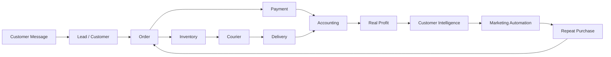
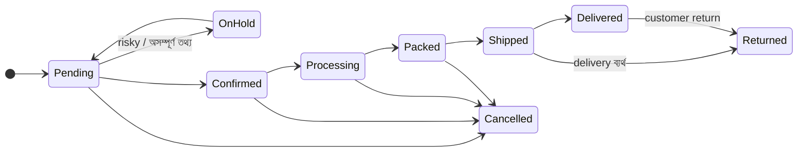
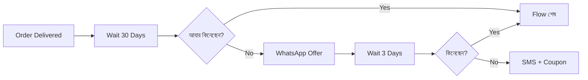

<div align="center">

# Business Operating System (BOS)

### Run the Business · Understand the Customer · Automate the Work · Grow the Business

**বাংলাদেশের উদ্যোক্তাদের জন্য একটি unified Business, Commerce, Customer Intelligence ও Growth Platform**

`Product Vision` · `Version 2.0` · `Bangla + English`

</div>

---

> [!IMPORTANT]
> **One-sentence definition**
>
> A Bangladesh-focused Business Operating System that connects **conversations, customers, commerce, payments, inventory, delivery, finance, marketing and AI** into one intelligent platform.
>
> **বাংলায়:** Customer থেকে Order, Payment থেকে Delivery, Accounting থেকে Profit এবং Marketing থেকে Repeat Purchase — পুরো business lifecycle একটি intelligent platform-এ।

---

## Quick Navigation

| Part | Section | এক কথায় |
|:---:|---|---|
| **I** | [Why BOS](#part-i--why-bos) | সমস্যা, সমাধান, কার জন্য |
| **II** | [Platform Structure](#part-ii--platform-structure) | 4 Pillars, Foundation, Module Map |
| **III** | [Modules](#part-iii--modules) | প্রতিটি module কী সমস্যা solve করে |
| **IV** | [The Business Loop](#part-iv--the-complete-business-loop) | Attract থেকে Grow — পুরো চক্র |
| **V** | [Product Principles](#part-v--product-principles) | Feature নয়, problem solve |
| **VI** | [Why We Win](#part-vi--why-bos-is-different) | অন্য tool থেকে পার্থক্য |
| **VII** | [Roadmap](#part-vii--roadmap) | কোনটা আগে, কোনটা পরে |
| **VIII** | [Final Vision](#part-viii--final-vision) | Merchant-এর সকালের ৮টি প্রশ্ন |

> [!NOTE]
> Technical business rules (state machines, formulas, accounting entries, tech stack) আছে আলাদা document-এ: [`bos-business-logics.md`](./bos-business-logics.md)

---

# Part I — Why BOS

## 1. The Problem: একটি business, দশটি আলাদা tool

আজ একজন online উদ্যোক্তা প্রতিদিন অনেকগুলো disconnected platform-এ কাজ করেন:

| কাজ | ব্যবহৃত tool | ফলাফল (Pain) |
|---|---|---|
| Customer-এর সাথে কথা | Facebook, Messenger, WhatsApp | Conversation আর order আলাদা জায়গায় |
| Order নেওয়া | Messenger chat, WooCommerce, খাতা | Order হারায়, duplicate হয় |
| Order confirm | নিজে phone call | প্রতিদিন ঘণ্টার পর ঘণ্টা call |
| Delivery | Courier panel (আলাদা আলাদা) | কোন parcel কোথায় — বোঝা কঠিন |
| Payment | bKash / Nagad app | Payment আর order মেলানো manual |
| হিসাব | Excel, খাতা | ভুল হিসাব, দেরি |
| Marketing | Ads Manager | Ad খরচ আর আসল profit-এর সম্পর্ক অজানা |
| Stock | মাথায় বা Excel-এ | Stock-out বা dead stock |

> [!WARNING]
> **মূল সমস্যা:** Data ছড়িয়ে আছে, তাই merchant জানেন **কত বিক্রি হলো**, কিন্তু জানেন না **আসলে কত লাভ হলো।**

## 2. The Solution: সবকিছু একটি connected system-এ

BOS এই fragmented workflow-কে একটি single business ecosystem-এ নিয়ে আসে, যেখানে প্রতিটি ধাপ পরের ধাপের সাথে **automatically connected**।



একজন merchant এক জায়গা থেকেই জানতে পারবেন:

> **কি বিক্রি হচ্ছে · কার কাছে বিক্রি হচ্ছে · কত টাকা আসছে · কোথায় খরচ হচ্ছে · কোন order risky · কোন customer আবার কিনবে · business-এর প্রকৃত profit কত**

## 3. Who It's For

| Merchant type | বর্তমান অবস্থা | BOS থেকে প্রধান লাভ |
|---|---|---|
| **F-commerce seller** | Facebook/Messenger থেকে COD order | Unified inbox, risk score, courier automation, real profit |
| **WooCommerce / website store** | নিজস্ব website আছে, back-office নেই | 1-click sync, inventory, accounting, CRM |
| **Online + physical shop** | দোকান ও online-এর stock আলাদা | POS + online একই inventory |
| **Wholesaler / B2B** | Reseller-দের বাকি ও আলাদা দাম | Price tiers, credit limit, due management |
| **Growing brand** | Team, warehouse, ads বাড়ছে | Roles, multi-warehouse, campaign profit, payroll |

## 4. Product Promise

<div align="center">

### One Business. One Platform. Complete Control.

</div>

| Operate | Money | Customer | Growth |
|---|---|---|---|
| Orders | Payments | Customers (CRM) | Marketing |
| Products & Inventory | Expenses | Conversations | Website & Landing Pages |
| Suppliers & Purchase | Accounting | Customer Support | Analytics |
| Courier & Delivery | Profit | Communication | AI Insights |
| Employees & Payroll | Cash Flow | Risk Intelligence | Automation |

---

# Part II — Platform Structure

## 5. The 4 Core Pillars

পুরো platform চারটি স্তম্ভের ওপর দাঁড়িয়ে, এবং সবগুলোর নিচে আছে একটি common **Foundation**।

| Pillar | উদ্দেশ্য | মূল প্রশ্ন | Modules |
|---|---|---|---|
| **RUN** | Business efficiently চালানো | "কাজগুলো কি ঠিকভাবে হচ্ছে?" | Orders · Inventory · Purchase · POS · Courier · Payments · Finance · HR |
| **UNDERSTAND** | Business-এর প্রকৃত অবস্থা বোঝা | "আসলে কী ঘটছে?" | CRM · Customer 360 · Risk · Profit · Analytics · Health Score |
| **GROW** | Business বড় করা | "কীভাবে আরও বিক্রি করব?" | Marketing · Segmentation · Campaign · Retargeting · Storefront |
| **AUTOMATE** | Manual কাজ কমানো | "কোন কাজ মানুষকে করতে হবে না?" | AI Chatbot · Voice Bot · Workflow Automation · AI Assistant |

```
┌──────────────┬──────────────┬──────────────┬──────────────┐
│     RUN      │  UNDERSTAND  │     GROW     │   AUTOMATE   │
├──────────────┴──────────────┴──────────────┴──────────────┤
│                      INTEGRATIONS                         │
│   WooCommerce · WordPress · Courier · Payment · Meta      │
├───────────────────────────────────────────────────────────┤
│                       FOUNDATION                          │
│   Multi-tenant · Roles · Audit · Security · Bangla/English│
└───────────────────────────────────────────────────────────┘
```

## 6. Module Map

সব module এক নজরে, pillar অনুযায়ী সাজানো।

| # | Module | Pillar | Section |
|:---:|---|:---:|:---:|
| F1 | Business Management (Tenant, Store, Branch, Roles) | Foundation | [7.1](#71-business-management) |
| F2 | Security & Control | Foundation | [7.2](#72-security--control) |
| F3 | Bangla + English & Mobile-first | Foundation | [7.3](#73-bangla--english--mobile-first) |
| R1 | Order Management | RUN | [8.1](#81-order-management) |
| R2 | Inventory Management | RUN | [8.2](#82-inventory-management) |
| R3 | Purchasing & Supplier | RUN | [8.3](#83-purchasing--supplier-management) |
| R4 | POS | RUN | [8.4](#84-pos-point-of-sale) |
| R5 | Courier Management | RUN | [8.5](#85-courier-management) |
| R6 | Bangladesh Payment Hub | RUN | [8.6](#86-bangladesh-payment-hub) |
| R7 | COD & Courier Reconciliation | RUN | [8.7](#87-cod--courier-reconciliation) |
| R8 | Accounting & Finance | RUN | [8.8](#88-accounting--finance) |
| R9 | Employee & Payroll | RUN | [8.9](#89-employee--payroll) |
| R10 | B2B & Wholesale | RUN | [8.10](#810-b2b--wholesale) |
| U1 | Advanced CRM & Customer 360 | UNDERSTAND | [9.1](#91-advanced-crm--customer-360) |
| U2 | Customer Risk Intelligence | UNDERSTAND | [9.2](#92-customer-risk-intelligence) |
| U3 | Courier Intelligence | UNDERSTAND | [9.3](#93-courier-intelligence) |
| U4 | Real Profit Engine | UNDERSTAND | [9.4](#94-real-profit-engine) |
| U5 | Customer Intelligence | UNDERSTAND | [9.5](#95-customer-intelligence) |
| U6 | Advanced Analytics | UNDERSTAND | [9.6](#96-advanced-analytics) |
| U7 | Business Health Score | UNDERSTAND | [9.7](#97-business-health-score) |
| G1 | Marketing Management | GROW | [10.1](#101-marketing-management) |
| G2 | Customer Segmentation | GROW | [10.2](#102-customer-segmentation) |
| G3 | Marketing Automation | GROW | [10.3](#103-marketing-automation) |
| G4 | Abandoned Cart Recovery | GROW | [10.4](#104-abandoned-cart-recovery) |
| G5 | Website & Store Builder | GROW | [10.5](#105-no-code-website--store-builder) |
| G6 | Landing Page Builder | GROW | [10.6](#106-landing-page-builder) |
| A1 | Social CRM & Unified Inbox | AUTOMATE | [11.1](#111-social-crm--unified-inbox) |
| A2 | AI Chatbot | AUTOMATE | [11.2](#112-ai-chatbot) |
| A3 | AI Voice Call Bot | AUTOMATE | [11.3](#113-ai-voice-call-bot) |
| A4 | AI Business Assistant | AUTOMATE | [11.4](#114-ai-business-assistant) |
| A5 | AI Daily Business Brief | AUTOMATE | [11.5](#115-ai-daily-business-brief) |
| I1 | WooCommerce Integration (Two-way) | Integration | [12.1](#121-woocommerce-integration) |
| I2 | WordPress Integration | Integration | [12.2](#122-wordpress-integration) |
| I3 | Migration Tooling | Integration | [12.3](#123-migration-tooling) |

---

# Part III — Modules

> [!TIP]
> **প্রতিটি module একই কাঠামোয় লেখা:**
> **Problem** (কী সমস্যা) → **What it does** (কী করে) → **Key capabilities** → **Outcome** (merchant কী পায়)

## 7. Foundation

### 7.1 Business Management

**Problem:** Business বড় হলে একাধিক store, branch, warehouse ও staff manage করা কঠিন হয়ে যায়।

**What it does:** প্রতিটি business-এর জন্য একটি নিরাপদ, আলাদা workspace — যেখানে structure, মানুষ ও permission সব নিয়ন্ত্রিত।

```
Business (Tenant)
 ├── Store / Brand        (এক business-এর একাধিক brand বা sales channel)
 │    └── Branch          (physical দোকান / office)
 │         └── Warehouse  (stock রাখার জায়গা)
 └── Users → Roles → Permissions
```

**Key capabilities**
- Multi-tenant SaaS — প্রতিটি business-এর data সম্পূর্ণ আলাদা
- Multiple stores, branches, warehouses
- Users, Roles & Permissions (যেমন: Sales Agent cost price ও profit দেখতে পারবে না)
- Approval Workflow — বড় discount, refund, purchase বা stock adjustment-এ অনুমোদন লাগবে
- Audit Log — কে, কখন, কী পরিবর্তন করেছে

**Outcome:** Owner নিশ্চিন্তে team-কে কাজ দিতে পারেন, কারণ প্রতিটি কাজ নিয়ন্ত্রিত ও traceable।

### 7.2 Security & Control

**Problem:** Business data, customer data ও টাকার হিসাব — এগুলোর নিরাপত্তা না থাকলে software-এ বিশ্বাস থাকে না।

| Area | Control |
|---|---|
| Data isolation | Tenant isolation — এক business অন্যের data কখনো দেখবে না |
| Access | Role-based permissions, 2FA |
| Traceability | প্রতিটি গুরুত্বপূর্ণ action-এর Audit log |
| Integrations | API authentication, rate limiting, webhook verification |
| Secrets | Payment / courier credentials encrypted অবস্থায় সংরক্ষিত |
| Continuity | Automatic backup ও disaster recovery |

**Outcome:** Business software হিসেবে bank-grade discipline — প্রতিটি টাকা ও প্রতিটি পরিবর্তনের হিসাব আছে।

### 7.3 Bangla + English & Mobile-first

**Problem:** অনেক merchant ও তাদের team English software-এ স্বচ্ছন্দ নন, এবং বেশিরভাগ কাজ হয় mobile-এ।

**Language** — Merchant dashboard থেকে এক click-এ বাংলা ↔ English। Localized হবে: Dashboard, Menu, Reports, Invoice, Notifications, Email, Customer communication ও Storefront। টাকা দেখাবে বাংলাদেশি format-এ (৳১,২৫,০০০)।

**Mobile** — Mobile dashboard-এ এক নজরে:

| Sales | Orders | Profit | Messages | Alerts | Stock |
|:---:|:---:|:---:|:---:|:---:|:---:|

**Path:** PWA → Android → iOS

---

## 8. RUN — Business চালানো

### 8.1 Order Management

**Problem:** Order আসে অনেক জায়গা থেকে, তাই order হারায়, duplicate হয়, status বোঝা যায় না।

**What it does:** সব channel-এর order এক জায়গায়, একটি স্পষ্ট lifecycle-এ।

**Order sources:** Messenger · WhatsApp · Instagram · WooCommerce · Own Website · Landing Page · POS · Manual · API · Chatbot

**Order lifecycle**



> [!NOTE]
> **Logical clarification:** একটি order-এর তিনটি আলাদা status থাকবে —
> **Order status** (উপরের lifecycle) · **Payment status** (Unpaid → Paid → Refunded) · **Shipment status** (courier থেকে)।
> তাই **"Refunded" হলো payment status**, order status নয়। এতে "refund হয়েছে কিন্তু return হয়নি"-এর মতো অসম্ভব অবস্থা তৈরি হয় না।

**Outcome:** কোনো order হারায় না, প্রতিটি order কোন ধাপে আছে তা এক নজরে দেখা যায়।

### 8.2 Inventory Management

**Problem:** Online ও offline-এ একই product বিক্রি হলে stock-এর হিসাব মেলে না — oversell বা dead stock হয়।

**What it does:** প্রতিটি product variant-এর stock, প্রতিটি warehouse-এ, real-time-এ।

| Master data | Stock tracking | Movement |
|---|---|---|
| Product, Category, Brand | On-hand Stock | Stock Transfer |
| SKU, Barcode | Reserved Stock (order-এ আটকে আছে) | Stock Adjustment |
| Variant (Size, Color) | **Available = On-hand − Reserved** | Stock Count |
| Warehouse | Damaged Stock | Full movement history |

**Smart Inventory** — System নিজে জানাবে:

| Signal | অর্থ |
|---|---|
| **Running out** | কোন product দ্রুত শেষ হয়ে যাচ্ছে |
| **Dead stock** | কোন product অনেক দিন বিক্রি হয়নি — টাকা আটকে আছে |
| **Reorder now** | কখন, কত পরিমাণ নতুন stock order করা উচিত |

**Outcome:** Stock-out-এ বিক্রি হারানো ও dead stock-এ টাকা আটকে থাকা — দুটোই কমে।

### 8.3 Purchasing & Supplier Management

**Problem:** Supplier-কে কত টাকা দেওয়া বাকি, কোন supplier নির্ভরযোগ্য — এগুলোর হিসাব থাকে না।

**Purchase flow**

```
Purchase Order → Approval → Goods Received → Purchase Invoice → Supplier Payment
                                   └──► Stock + Product Cost automatically update
```

**Key capabilities:** Supplier · Purchase Order · Purchase Invoice · Purchase Return · Supplier Due · Supplier Payment · Supplier Ledger · Supplier Performance (সময়মতো delivery, quality, দাম)

**Outcome:** সঠিক product cost জানা যায় (যা আসল profit হিসাবের ভিত্তি) এবং supplier due কখনো ভুল হয় না।

### 8.4 POS (Point of Sale)

**Problem:** দোকানের বিক্রি আর online বিক্রি আলাদা system-এ থাকলে stock ও হিসাব মেলে না।

**What it does:** Physical store-এর জন্য দ্রুত billing — একই inventory, একই customer, একই accounting।

| Billing | Payment | Control |
|---|---|---|
| Barcode scan | Cash, bKash, Card (split payment) | Cashier shift open/close |
| Product search | Discount (permission অনুযায়ী) | Cash count ও variance |
| Cart & Customer | Invoice / Receipt print | Instant stock update |

**Outcome:** Online ও offline — এক business, এক হিসাব।

### 8.5 Courier Management

**Problem:** প্রতিটি courier-এর আলাদা panel, আলাদা area list, আলাদা status — manually booking ও tracking-এ সময় নষ্ট।

**What it does:** Pathao, Steadfast, RedX, Paperfly, eCourier সহ courier-দের সাথে direct integration।

```
Order Packed → One-click Courier Booking → Label Print → Live Tracking → Delivered / Returned
                                                              └──► Customer-কে automatic SMS/WhatsApp
```

**Outcome:** Booking ও tracking automatic; কোন parcel কোথায় আছে তা BOS থেকেই দেখা যায়।

### 8.6 Bangladesh Payment Hub

**Problem:** bKash/Nagad-এ টাকা এলো কিনা, কোন order-এর টাকা — মিলাতে হয় manually, এবং fake screenshot-এর ঝুঁকি থাকে।

**Supported methods:** bKash · Nagad · Upay · SSLCOMMERZ · Card · Bank · COD

**Payment journey**

```
Payment → Verification → Reconciliation → Accounting
```

> [!IMPORTANT]
> **Trust rule:** Customer-এর screen-এ দেখানো "Payment Successful" বা screenshot কখনো final truth নয়।
> Payment confirm হবে শুধু **server-side verification** এবং **gateway callback / IPN**-এর মাধ্যমে।

**Additional:** Payment link পাঠানো (chat থেকেই), risky COD order-এ advance delivery charge নেওয়া, refund।

**Outcome:** প্রতিটি টাকা সঠিক order-এর সাথে verified ও reconciled।

### 8.7 COD & Courier Reconciliation

**Problem:** Courier কত টাকা পাঠালো আর কত পাঠানোর কথা ছিল — এই হিসাব প্রায় কেউ মেলায় না, ফলে টাকা হারায়।

**Formula**

| | Item |
|:---:|---|
| | Delivered (collected) Amount |
| − | Courier Delivery Charge |
| − | COD Charge |
| − | Return Charge & Other Adjustments |
| **=** | **Expected Settlement** |

তারপর **Expected Settlement** vs **Actual Courier Payout** মিলিয়ে দেখানো হবে:

| Result | অর্থ |
|---|---|
| Matched | হিসাব মিলেছে |
| Short paid | Courier কম টাকা দিয়েছে |
| Charge mismatch | Rate card-এর চেয়ে বেশি charge কেটেছে |
| Missing | Delivered কিন্তু payout-এ নেই |

**Outcome:** Courier-এর কাছে কত টাকা পাওনা, তা সবসময় জানা থাকে — কোনো টাকা চুপচাপ হারায় না।

### 8.8 Accounting & Finance

**Problem:** Excel বা খাতায় হিসাব রাখলে business-এর প্রকৃত financial অবস্থা কখনো স্পষ্ট হয় না।

**What it does:** Order, payment, purchase, courier ও payroll থেকে **automatic double-entry accounting** — আলাদা করে entry দিতে হয় না।

| Records | Ledgers | Reports |
|---|---|---|
| Income, Expense | Journal, Ledger | Profit & Loss |
| Payment, Refund, Return | Receivable (পাওনা) | Balance Sheet |
| Supplier Due | Payable (দেনা) | Cash Flow |
| Courier Settlement | Accounts (Cash, Bank, bKash) | Trial Balance |
| Payroll | | |

**Outcome:** এক click-এ business-এর প্রকৃত financial position।

### 8.9 Employee & Payroll

**Problem:** Attendance, ছুটি, বেতন ও sales commission-এর হিসাব manually করা সময়সাপেক্ষ ও ভুলপ্রবণ।

| People | Time | Pay |
|---|---|---|
| Employee | Attendance | Salary |
| Department | Leave | Bonus (যেমন Eid bonus) |
| Designation | | Commission |
| | | Advance & Deduction |
| | | **Payroll** |

**Key logic:** Salesperson-এর commission automatic calculate হবে — শুধু **delivered** order-এর ওপর, এবং return হলে adjust হবে।

**Outcome:** মাসের শেষে কয়েক মিনিটে সঠিক payroll।

### 8.10 B2B & Wholesale

**Problem:** Reseller ও wholesale customer-দের দাম আলাদা, বাকিতে বিক্রি হয় — retail system-এ এগুলো ধরা যায় না।

**Key capabilities**
- Wholesale customer-দের জন্য custom pricing tiers
- Volume-based discount (যত বেশি qty, তত কম দাম)
- B2B bulk order processing
- B2B customer registration ও approval
- Reseller-দের credit limit ও due management

**Outcome:** Retail ও wholesale — দুই business একই platform-এ।

---

## 9. UNDERSTAND — Business বোঝা

### 9.1 Advanced CRM & Customer 360

**Problem:** Customer মানে শুধু একটি phone number — তার মূল্য, আচরণ বা ইতিহাস কেউ জানে না।

**What it does:** প্রতিটি customer-এর একটি complete profile।

| Value | Behaviour | Relationship |
|---|---|---|
| Total Orders | Purchase History | Conversations |
| Total Spending | Preferred Products | Customer Tags |
| Total Profit | Cancelled Orders | Customer Segment |
| Lifetime Value | Returned Orders | Risk Score |
| Last Purchase | Courier History | |

**Outcome:** Customer-এর শুধু phone number নয় — পুরো relationship বোঝা যায়।

### 9.2 Customer Risk Intelligence

**Problem:** COD order-এর একটি বড় অংশ return হয় — প্রতিটি return মানে courier charge ও সময় নষ্ট।

**What it does:** প্রতিটি order-এর সময় customer-এর automatic risk score।

**Risk signals:** আগের cancellation · Return history · Delivery failure · Courier history · Order behaviour · Address quality · Payment behaviour

| Risk level | Recommended action |
|---|---|
| **Low** | সরাসরি confirm করা যায় |
| **Medium** | Call / voice bot দিয়ে confirm |
| **High** | Confirm + advance delivery charge নেওয়ার পরামর্শ |
| **Very High** | Hold — advance payment ছাড়া পাঠানো ঝুঁকিপূর্ণ |

প্রতিটি score-এর সাথে **কারণ** দেখানো হবে (যেমন: "শেষ ৩টি parcel-এর ২টি return হয়েছে")।

**Outcome:** Order নেওয়ার মুহূর্তেই merchant জানেন — **এই customer-এর COD order কতটা safe।**

### 9.3 Courier Intelligence

**Problem:** কোন customer আগে parcel return করেছে বা কোন courier কোন এলাকায় ভালো — এই তথ্য কোথাও একত্রে নেই।

**Customer-level (phone number দিয়ে):**

| Previous parcels | Delivered | Cancelled | Returned | Success rate | Risk |
|:---:|:---:|:---:|:---:|:---:|:---:|

**Future — Best courier recommendation:**

```
Customer + Location + Courier Performance + Cost  →  Recommended Courier
```

**Outcome:** Delivery success বাড়ে, return loss কমে।

### 9.4 Real Profit Engine

**Problem:** বেশিরভাগ merchant **sales**-কে **profit** ভাবেন — অথচ courier, ad, return খরচ বাদ দিলে আসল লাভ অনেক কম।

**What it does:** প্রতিটি order-এর actual profitability।

| Item | Amount |
|---|---:|
| Selling Price | ৳2,000 |
| − Product Cost | ৳900 |
| − Courier | ৳80 |
| − Packaging | ৳30 |
| − Payment Fee | ৳25 |
| − Marketing Cost | ৳200 |
| − Return Cost Allocation | ৳50 |
| **= Actual Contribution Profit** | **৳715** |

> [!CAUTION]
> **Revenue ≠ Profit.** ৳2,000-এর বিক্রিতে আসল লাভ ৳715 (35.75%)।

Profit দেখা যাবে: Order · Product · Customer · Channel · Campaign · Courier · Salesperson অনুযায়ী।

**Outcome:** Merchant জানেন কোন product, customer ও campaign আসলে টাকা আনছে আর কোনটা টাকা খাচ্ছে।

### 9.5 Customer Intelligence

**Problem:** সব customer-কে একই message পাঠালে খরচ বাড়ে, ফল কমে।

**What it does:** System automatically প্রতিটি customer-কে চিনে নেয়:

| Label | অর্থ |
|---|---|
| **New** | প্রথমবার কিনেছেন |
| **Repeat** | একাধিকবার কিনেছেন |
| **VIP** | সবচেয়ে মূল্যবান customer |
| **Potential VIP** | VIP হওয়ার পথে |
| **High-value** | Lifetime value বেশি |
| **At-Risk** | স্বাভাবিক সময়ের চেয়ে অনেকদিন কেনেননি |
| **Lost** | দীর্ঘদিন কোনো order নেই |
| **High-return** | Return rate বেশি |

**Goal:** **Right customer → Right message → Right time → Right offer**

### 9.6 Advanced Analytics

**Problem:** আলাদা আলাদা tool-এর report মিলিয়ে business-এর ছবি পাওয়া অসম্ভব।

**What it does:** একটি unified dashboard, সব metric-এর একই সংজ্ঞা।

| Area | Metrics |
|---|---|
| **Sales** | Revenue · Orders · AOV · Conversion |
| **Customer** | New · Repeat · Retention · LTV · Churn |
| **Operations** | Delivery · Return · Cancellation · Stock |
| **Finance** | Revenue · Expense · Profit · Cash Flow |
| **Marketing** | Spend · CAC · ROAS · Revenue · **Profit** |

### 9.7 Business Health Score

**Problem:** অনেক metric দেখে business ভালো চলছে কিনা — সহজে বোঝা যায় না।

**What it does:** একটি সহজ score, সাথে ব্যাখ্যা।

<div align="center">

### Business Health: 78 / 100

</div>

| Component | মাপা হয় |
|---|---|
| Sales Growth | বিক্রি বাড়ছে কিনা |
| Profit Margin | প্রতিটি বিক্রিতে লাভ |
| Cash Flow | হাতে টাকা আছে কিনা |
| Customer Retention | Customer ফিরে আসছে কিনা |
| Return Rate | কত parcel ফেরত আসছে |
| Inventory Health | Dead stock ও stock-out |
| Marketing ROI | Ad-এর টাকা ফেরত আসছে কিনা |
| Delivery Success | কত parcel সফলভাবে পৌঁছাচ্ছে |

System বলে দেবে: **কেন score কমেছে, এবং কী করলে বাড়বে।**

---

## 10. GROW — Business বড় করা

### 10.1 Marketing Management

**Problem:** Ads Manager বলে ROAS ভালো, কিন্তু return ও খরচ বাদে campaign আসলে লাভজনক কিনা জানা যায় না।

**Key capabilities:** Campaign · Audience · Customer Segment · Retargeting · Pixel · Conversion Tracking · Marketing Analytics

**Campaign profit chain**

```
Ad Spend → Orders → Delivered Orders → Revenue → Actual Profit
```

**Outcome:** শুধু ROAS নয় — প্রতিটি campaign-এর **actual profit**।

### 10.2 Customer Segmentation

**Problem:** কাকে target করবেন, সেই list বানানো কঠিন।

**What it does:** Condition দিয়ে নিজের audience তৈরি — যেমন, customers who:

- ৳5,000-এর বেশি খরচ করেছেন
- ৩ বারের বেশি কিনেছেন
- গত ৬০ দিনে কেনেননি
- ঢাকায় থাকেন
- Return rate কম

**Reach via:** WhatsApp · SMS · Email · Ad Campaign

### 10.3 Marketing Automation

**Problem:** প্রতিটি customer-কে সঠিক সময়ে follow-up করা মানুষের পক্ষে সম্ভব নয়।

**What it does:** Visual automation builder — **Trigger → Condition → Action**

**Example: Repeat purchase flow**



> [!NOTE]
> **Customer-friendly rules:** Customer কিনে ফেললে flow সাথে সাথে বন্ধ হবে; marketing message শুধু consent থাকলে; রাতে কোনো message নয়; এক সপ্তাহে message-এর সীমা থাকবে।

### 10.4 Abandoned Cart Recovery

**Problem:** অনেক customer cart-এ product রেখে চলে যান — সেই বিক্রি হারিয়ে যায়।

| Time after leaving | Action |
|:---:|---|
| **30 min** | Reminder |
| **6 hours** | Product reminder (ছবি ও দামসহ) |
| **24 hours** | Offer / Coupon |

Customer order করলেই বাকি follow-up বন্ধ।

**Outcome:** হারানো বিক্রির একটি অংশ automatically ফিরে আসে।

### 10.5 No-Code Website & Store Builder

**Problem:** Website builder-গুলোতে সব store একই রকম দেখায়, আর custom website বানাতে developer লাগে।

> **Principle:** একই platform-এ হাজার website — কিন্তু কোনো দুটি একই রকম নয়।
> **Every merchant can build a different storefront.**

**Two ways to start**

| Template-first | Blank canvas |
|---|---|
| Template select → নিজের মতো customize | শূন্য থেকে নিজের design |

**Drag-and-drop blocks:** Header · Hero · Banner · Product Grid · Category · Product Carousel · Offer · Countdown · Testimonials · Reviews · FAQ · CTA · Footer · Custom Sections

Block add, remove, resize ও reorder করা যাবে।

**Design freedom**

| Style | Layout | Content |
|---|---|---|
| Typography | Spacing | Sections |
| Colors | Navigation | Product presentation |
| Buttons | Mobile layout | Images |
| | Desktop layout | Banners |

**Fast eCommerce Engine** — Website হবে **Fast · Mobile-first · SEO-friendly · App-like**

| Speed | Delivery | Experience |
|---|---|---|
| SSR / smart rendering | CDN | Prefetching |
| Image optimization (WebP/AVIF) | Caching (Redis) | Optimistic UI |
| Lazy loading | Database & API optimization | Page reload-এর অনুভূতি ছাড়া smooth navigation |
| Code splitting | | |

**Outcome:** Technical জ্ঞান ছাড়াই নিজের brand-এর মতো unique, দ্রুত, বিক্রি-বান্ধব store।

### 10.6 Landing Page Builder

**Problem:** প্রতিটি campaign-এর জন্য আলাদা landing page বানাতে developer লাগে।

**What it does:** Campaign-specific landing page — coding ছাড়াই, ভেতরেই checkout।

```
Ad → Landing Page → Product → Checkout → Order
```

**Outcome:** দ্রুত campaign launch, কম ধাপে বেশি conversion।

---

## 11. AUTOMATE — Manual কাজ কমানো

### 11.1 Social CRM & Unified Inbox

**Problem:** Messenger, Instagram, WhatsApp-এ আলাদা আলাদা reply দিতে হয়, আর conversation থেকে order আলাদা জায়গায় লিখতে হয়।

**What it does:** সব conversation একটি unified inbox-এ — এবং সেখান থেকেই commerce।

| Conversation | Commerce | Support |
|---|---|---|
| Message দেখা ও reply | Product পাঠানো | Support ticket তৈরি |
| Customer identify (360 profile পাশে) | Order তৈরি | Agent assignment |
| Internal notes | Payment request পাঠানো | Refund / return শুরু |
| AI assistance | | Human handoff |

> **Core Idea:** Conversation এবং Commerce আলাদা থাকবে না।

### 11.2 AI Chatbot

**Problem:** Customer-রা রাত-দিন একই প্রশ্ন করেন — দেরিতে reply দিলে বিক্রি হারায়।

**Example conversation**

> **Customer:** "Black shirt টার price কত?"
>
> **Bot:** "Black Premium Shirt-এর দাম ৳1,250। বর্তমানে Medium ও Large available।"
>
> **Customer:** "একটা Medium দেন।"
>
> **Bot:** নাম, phone, ঠিকানা নেবে → delivery charge সহ মোট দাম দেখাবে → customer "হ্যাঁ" বললে order তৈরি করবে।

**Rules**
- দাম ও stock সবসময় live system থেকে — bot নিজে কখনো বানিয়ে বলবে না
- Customer-এর স্পষ্ট confirmation ছাড়া order হবে না

**Human Handoff:** Customer মানুষ চাইলে, অভিযোগ থাকলে, বা bot নিশ্চিত না হলে —

```
AI → Human Agent   (পুরো conversation-এর context সহ)
```

**Outcome:** দ্রুত reply, ২৪/৭ বিক্রি, agent-দের সময় বাঁচে।

### 11.3 AI Voice Call Bot

**Problem:** প্রতিটি COD order confirm করতে merchant-কে manually call করতে হয় — প্রতিদিন ঘণ্টার পর ঘণ্টা।

**Example call**

> **Voice Bot:** "আসসালামু আলাইকুম। আপনি কি আপনার Premium Black Shirt-এর order টি confirm করতে চান?"

| Press | Action | Result |
|:---:|---|---|
| **1** | Order Confirm | Order → Confirmed |
| **2** | Product সম্পর্কে আরও জানতে চাই | Product details শোনানো |
| **3** | Order Cancel | Order → Cancelled |
| **4** | Customer Support | Agent-এর কাছে callback |

**Use cases:** Order confirmation · COD confirmation · Delivery confirmation · Customer verification · Abandoned order follow-up · Product information · Support routing · Callback

> [!NOTE]
> Call হবে শুধু applicable API/platform support এবং customer consent ও policy মেনে, নির্দিষ্ট সময়ের মধ্যে (রাতে নয়)।

**Outcome:** Manual call ছাড়াই order confirmation — confirmation rate বাড়ে, fake order কমে।

### 11.4 AI Business Assistant

**Problem:** Business-এর প্রশ্নের উত্তর পেতে report ঘাঁটতে হয়।

**What it does:** Merchant সরাসরি business-এর সাথে কথা বলবেন — বাংলায় বা English-এ।

| প্রশ্ন | Assistant যা করবে |
|---|---|
| "আজকে আমার profit কত?" | আজকের real profit, আগের দিনের সাথে তুলনা |
| "গত মাসে সবচেয়ে profitable product কোনটা?" | Profit অনুযায়ী top products |
| "কোন customer-দের retarget করা উচিত?" | At-risk ও potential VIP list |
| "কোন product stock-out হতে যাচ্ছে?" | কত দিনে শেষ হবে, কত order করতে হবে |
| "আমার return rate কেন বেড়েছে?" | এলাকা, courier, product অনুযায়ী কারণ |

উত্তর আসবে business-এর আসল data থেকে, user-এর permission মেনে।

### 11.5 AI Daily Business Brief

**Problem:** Owner-এর প্রতিদিন সব report দেখার সময় নেই।

**What it does:** প্রতিদিন সকালে system নিজে জানাবে:

| Performance | Attention needed |
|---|---|
| Yesterday Sales | Low Stock |
| Orders | Risky Orders |
| Profit | Inactive Customers |
| Top Product | Marketing Performance |

এবং শেষে সবচেয়ে গুরুত্বপূর্ণ অংশ: **"আজ আপনার কী করা উচিত?"**

---

## 12. Integrations

### 12.1 WooCommerce Integration

**Problem:** যাদের WooCommerce store আছে, তারা নতুন website বানাতে চান না।

**Principle:** Existing business-কে নতুন website বানাতে বাধ্য করা হবে না।

**One-click connect:** `WooCommerce → Business OS`

**Initial import:** Products · Customers · Orders · Categories · Stock

**Two-way sync**

| Direction | Data |
|---|---|
| **WooCommerce → BOS** | Order · Customer · Product · Stock · Status |
| **BOS → WooCommerce** | Product · Stock · Price · Order status · Customer |

**Reliability:** Real-time webhook + queue, retry, idempotency (একই event দুবার process হবে না) ও sync log।

**Outcome:** Website যেমন আছে তেমনই থাকে, কিন্তু পেছনে পুরো BOS-এর শক্তি।

### 12.2 WordPress Integration

**Future:** WordPress REST API দিয়ে Pages, Posts, Media, Users ও Custom Content-এর সাথে integration।

### 12.3 Migration Tooling

**Problem:** নতুন system-এ যেতে ভয়ের সবচেয়ে বড় কারণ — পুরনো data হারানো।

| Source | Method |
|---|---|
| WooCommerce | 1-click sync & migration |
| Shopify | API import |
| Daraz | Seller data import |
| Excel / CSV | Smart column mapping |

**Key capabilities:** Customers, Products, Orders ও Stock import · Business বন্ধ না রেখেই migration · Category ও variant auto-mapping · Error report ও re-import

---

# Part IV — The Complete Business Loop

পুরো product-এর সবচেয়ে সহজ ব্যাখ্যা — একটি চক্র, যেখানে প্রতিটি বিক্রি পরের বিক্রিকে সহজ করে।


| Stage | কী ঘটে | BOS modules |
|---|---|---|
| **ATTRACT** | Customer আসে | Ads · Social Media · Website · Landing Page |
| **CONVERT** | কথা বলে, আগ্রহী হয় | Unified Inbox · Chatbot · Voice Bot |
| **SELL** | Order ও payment | Orders · Payment Hub · POS · Checkout |
| **DELIVER** | Product পৌঁছায় | Inventory · Warehouse · Courier · Tracking |
| **ACCOUNT** | টাকার হিসাব | Payments · Expense · Accounting · Real Profit |
| **UNDERSTAND** | Data থেকে শেখা | CRM · Customer Intelligence · Analytics |
| **RETARGET** | সঠিক customer-কে আবার পৌঁছানো | Segmentation · Campaign · Automation |
| **RETAIN** | Customer ধরে রাখা | Offers · Follow-up · WhatsApp · SMS · Loyalty |
| **GROW** | ভবিষ্যতের সিদ্ধান্ত | AI · Forecasting · Recommendations · Health Score |

---

# Part V — Product Principles

আমরা feature-এর সংখ্যা দিয়ে product measure করব না। প্রতিটি feature-এর আগে একটি প্রশ্ন:

> ### "এটা merchant-এর কোন real problem solve করছে?"

| Feature | শুধু এজন্য নয় | বরং আসলে |
|---|---|---|
| **AI Chatbot** | AI দেখানোর জন্য | Response time কমাবে, sales process automate করবে |
| **AI Voice Bot** | Voice technology দেখানোর জন্য | Manual confirmation call কমাবে, confirmation rate বাড়াবে |
| **Courier Integration** | API connect করার জন্য | Delivery automate করবে, delivery success বাড়াবে |
| **Risk Score** | একটি সংখ্যা দেখানোর জন্য | High-risk COD order চিনে loss কমাবে |
| **Accounting** | শুধু হিসাব রাখার জন্য | প্রকৃত financial position ও profit বোঝাবে |
| **Marketing Automation** | শুধু message পাঠানোর জন্য | Repeat purchase ও retention বাড়াবে |
| **CRM** | শুধু customer info রাখার জন্য | প্রতিটি customer-এর value ও behaviour বোঝাবে |
| **Website Builder** | শুধু website বানানোর জন্য | Technical জ্ঞান ছাড়াই unique brand storefront দেবে |
| **Fast eCommerce Engine** | শুধু speed-এর জন্য | Customer experience ও conversion বাড়াবে |
| **WooCommerce Integration** | শুধু data sync-এর জন্য | Migration ছাড়াই advanced management দেবে |
| **AI Business Assistant** | শুধু chatbot-এর জন্য | Owner-কে দ্রুত ও সঠিক সিদ্ধান্ত নিতে সাহায্য করবে |

**আরও তিনটি নীতি**

| Principle | অর্থ |
|---|---|
| **Truth over convenience** | Payment, stock, profit — সবসময় verified data থেকে; অনুমান হলে স্পষ্টভাবে "estimated" লেখা থাকবে |
| **Connected by default** | একটি কাজ একবারই হবে — order থেকে stock, accounting, CRM সব নিজে update হবে |
| **Local first** | বাংলাদেশের COD, courier, bKash/Nagad, বাংলা ভাষা — এগুলো add-on নয়, মূল ভিত্তি |

---

# Part VI — Why BOS Is Different

| Compared to | তারা দেয় | BOS অতিরিক্ত দেয় |
|---|---|---|
| **Traditional ERP** | Accounting, inventory | Social commerce, COD risk, courier, AI — বাংলাদেশি online business-এর বাস্তবতা |
| **WooCommerce / Shopify** | Online store | Back-office, accounting, courier reconciliation, real profit, inbox |
| **CRM tools** | Customer list | Order, delivery ও profit-এর সাথে connected customer value |
| **Courier panels** | Parcel booking | Multi-courier, reconciliation, customer risk, courier recommendation |
| **Excel / খাতা** | নমনীয়তা | Automation, accuracy, real-time insight |

> **BOS-এর মূল পার্থক্য:** অন্যরা একটি অংশ solve করে। BOS পুরো চক্রটি connect করে — তাই শুধু BOS-ই বলতে পারে **কোন conversation থেকে কোন order, কোন courier, কত খরচ, এবং শেষে কত আসল লাভ।**

---

# Part VII — Roadmap

প্রতিটি phase নিজেই merchant-এর জন্য ব্যবহারযোগ্য — পরের phase-এর জন্য অপেক্ষা করতে হবে না।

| Phase | Theme | Merchant কী পাবেন |
|:---:|---|---|
| **0** | Foundation | Secure multi-tenant platform, roles, audit, Bangla/English |
| **1** | **RUN core (MVP)** | Orders, inventory, CRM basics, risk score, courier integration, COD reconciliation, real profit, WooCommerce sync |
| **2** | Commerce & Finance | Payment hub, accounting, purchasing, POS, unified inbox, website & landing page builder |
| **3** | Grow & Automate | AI chatbot, voice bot, segmentation, campaigns, automation, abandoned cart, ad profit tracking |
| **4** | Intelligence & Scale | AI assistant, daily brief, health score, courier recommendation, payroll, B2B, advanced migration, mobile apps |

---

# Part VIII — Final Vision

একজন উদ্যোক্তা সকালে dashboard খুলে কয়েক সেকেন্ডেই জানবেন:

| # | প্রশ্ন | উত্তর দেবে |
|:---:|---|---|
| 1 | আজ কত sales হয়েছে? | Analytics |
| 2 | আসল profit কত? | Real Profit Engine |
| 3 | কোন order risky? | Risk Intelligence |
| 4 | কোন customer আবার কিনতে পারে? | Customer Intelligence |
| 5 | কোন product শেষ হয়ে যাচ্ছে? | Smart Inventory |
| 6 | কোন courier ভালো perform করছে? | Courier Intelligence |
| 7 | কোন campaign profitable? | Marketing Profit |
| 8 | আজ business-এর জন্য কী করা উচিত? | AI Daily Brief |

> [!IMPORTANT]
> **সবচেয়ে গুরুত্বপূর্ণ:** Business owner software-কে শুধু data entry tool হিসেবে ব্যবহার করবেন না —
> **software নিজেই business-এর intelligent operating partner হিসেবে কাজ করবে।**

---

<div align="center">

## Business Operating System

**Run the Business · Understand the Customer · Automate the Work · Grow the Business**

*Related:* [`bos-business-logics.md`](./bos-business-logics.md) — Technical business logic & architecture

</div>
